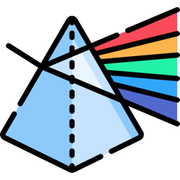
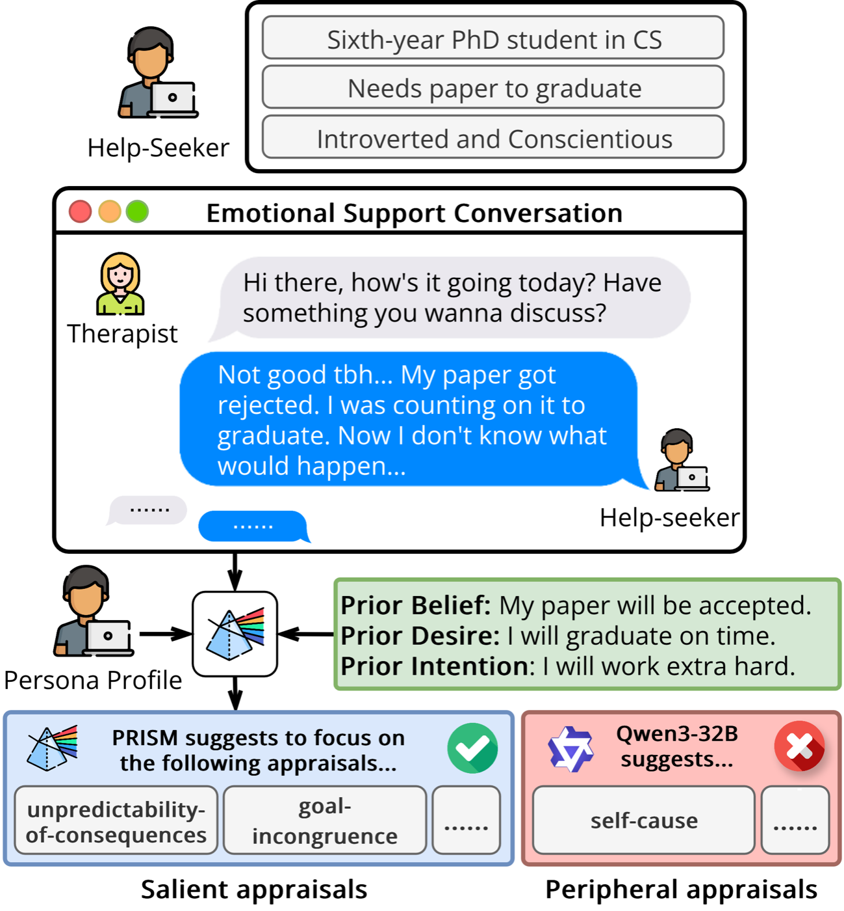
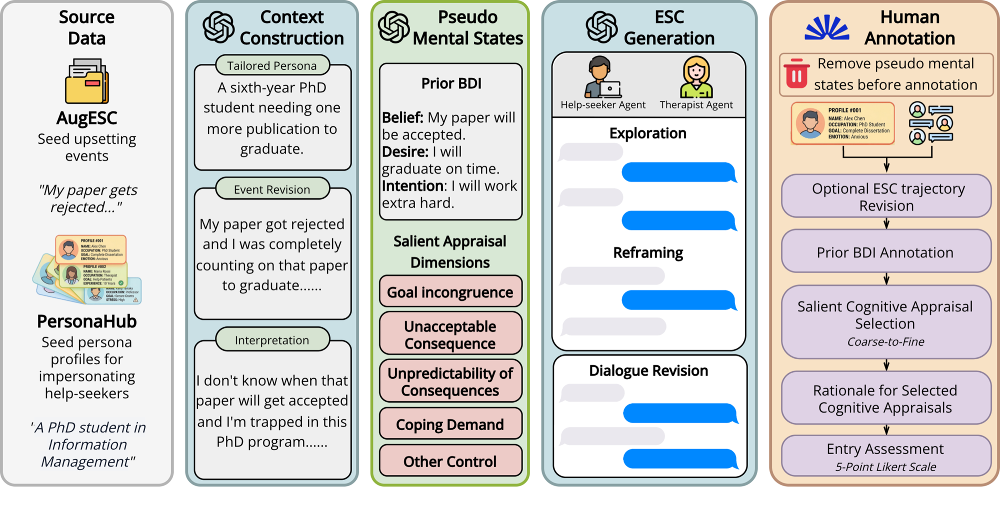
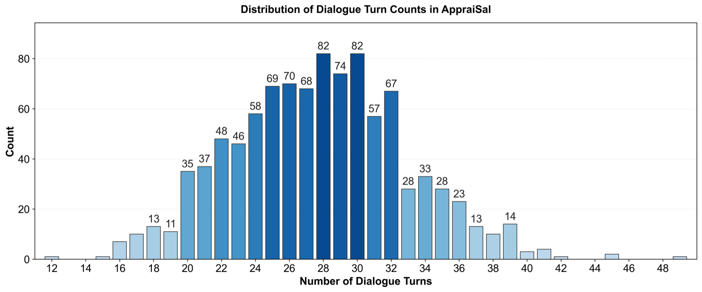
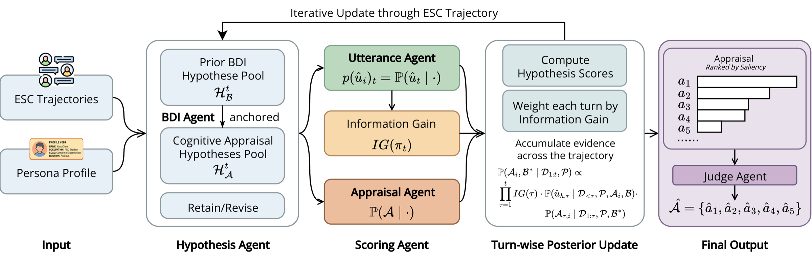
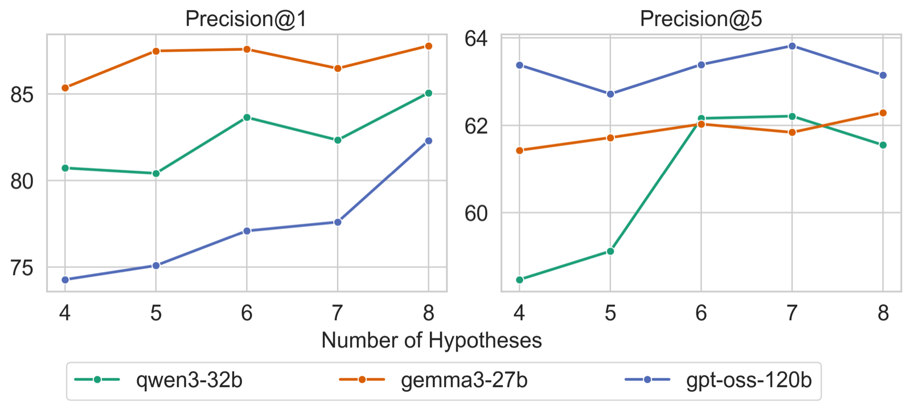
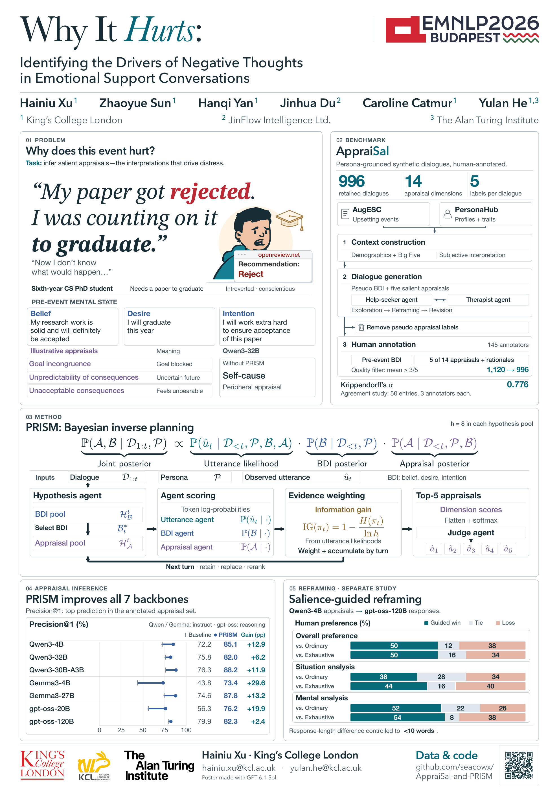

<div align="center">



# *Why It Hurts:* Identifying the Drivers of Negative Thoughts in Emotional Support Conversations

**Hainiu Xu**<sup>1</sup> · **Zhaoyue Sun**<sup>1</sup> · **Hanqi Yan**<sup>1</sup> · **Jinhua Du**<sup>2</sup> · **Caroline Catmur**<sup>1</sup> · **Yulan He**<sup>1,3</sup>

<sup>1</sup>King's College London · <sup>2</sup>JinFlow Intelligence Ltd. · <sup>3</sup>The Alan Turing Institute

**EMNLP 2026**

[](https://arxiv.org/abs/2607.28648)
[](https://huggingface.co/datasets/SeacowX/AppraiSal)
[](assets/poster.pdf)
[](LICENSE)

</div>

---

<p align="center">
  
</p>

A final-year PhD student whose paper is rejected may be distressed because the rejection **blocks a critical goal** (*they need it to graduate*) or because **the consequences are uncertain** (*they don't know what happens next*). Each interpretation is a different **cognitive appraisal**, and effective emotional support depends on knowing which appraisals are actually *salient*.

This repository releases:

- **AppraiSal** (**Apprai**sal **Sal**iency): a benchmark of **996** emotional support conversations (ESCs) with human-annotated pre-event beliefs, desires and intentions (BDI) and the **5 most salient** of 14 cognitive appraisal dimensions.
- **PRISM** (**PR**obabilistic **I**nference of **S**alient **M**ental States): a multi-agent probabilistic framework grounded in Bayesian Inverse Planning (BIP) that improves LLMs' ability to infer context-specific appraisals.

> [!NOTE]
> The AppraiSal dataset is available now on Hugging Face at [`SeacowX/AppraiSal`](https://huggingface.co/datasets/SeacowX/AppraiSal). **The code for PRISM will be available soon.**

## News

- The AppraiSal dataset is released on [Hugging Face](https://huggingface.co/datasets/SeacowX/AppraiSal).
- *Why It Hurts* is accepted to **EMNLP 2026**. The paper is on [arXiv](https://arxiv.org/abs/2607.28648).
- **Coming soon**: PRISM code (see [`prism/`](prism/)).

## Contents

- [The AppraiSal Dataset](#the-appraisal-dataset)
- [The PRISM Framework](#the-prism-framework)
- [Results](#results)
- [Poster](#poster)
- [Citation](#citation)
- [Ethics and Intended Use](#ethics-and-intended-use)

## The AppraiSal Dataset

### Task: salient appraisal reasoning

Given a dialogue trajectory $\mathcal{D}$ between a help-seeker and a therapist, the help-seeker's persona $\mathcal{P}$, and a set of 14 appraisal dimensions $\mathcal{A}$, a model estimates the saliency $\mathbb{P}(a_i \mid \mathcal{D}, \mathcal{P})$ of each dimension and returns the top-$k$ ($k \le 5$) most salient ones.

### Construction

<p align="center">
  
</p>

1. **Context construction.** Upsetting events are seeded from [AugESC](https://github.com/thu-coai/AugESC) and paired with a tailored persona (demographics and Big Five traits) built from [PersonaHub](https://huggingface.co/datasets/proj-persona/PersonaHub). The event is rewritten from the help-seeker's perspective along with their subjective negative interpretation.
2. **Pseudo mental states and ESC generation.** Pseudo pre-event BDI and 5 salient appraisals ground a dual-agent (help-seeker / CBT therapist) generation with `gpt-oss-120b`, following an *Exploration* → *Reframing* procedure. Trajectories are then revised with `GPT-5-mini`.
3. **Human annotation.** Pseudo appraisal labels are removed. 145 Prolific annotators revise the dialogue, infer the pre-event BDI, select **exactly five** salient appraisals with a rationale for each (coarse-to-fine), and rate quality on a 5-point scale. Entries with a mean rating below 3.0 are filtered out (1,120 → **996**).

### Statistics

| Entries | Annotators | Avg. turns | Avg. words / turn (therapist · help-seeker) |
| :-: | :-: | :-: | :-: |
| 996 | 145 | 27.77 ± 5.15 | 23.92 · 31.72 |

Inter-annotator agreement on 50 entries triple-annotated:

| Jaccard A1\|A2 | Jaccard A1\|A3 | Jaccard A2\|A3 | Mean Jaccard | Krippendorff's α |
| :-: | :-: | :-: | :-: | :-: |
| 0.749 | 0.787 | 0.791 | 0.776 | 0.776 |

<details>
<summary><b>Genre distribution</b></summary>

| Genre | Count | % |
| --- | --: | --: |
| Workplace & Career Challenges | 452 | 45.4 |
| Parenting & Caregiving Burden | 90 | 9.0 |
| Identity & Self-Worth | 77 | 7.7 |
| Mental Health & Psychological Distress | 71 | 7.1 |
| Family, Friendship & Social Conflict | 68 | 6.8 |
| Financial & Housing Stress | 51 | 5.1 |
| Work-Life Balance & Burnout | 48 | 4.8 |
| Grief, Loss & Trauma | 43 | 4.3 |
| Romantic & Intimate Relationships | 38 | 3.8 |
| Academic & Learning Stress | 32 | 3.2 |
| Safety, Security & Existential Threats | 13 | 1.3 |
| Physical Health & Medical Concerns | 8 | 0.8 |
| Immigration & Legal Stress | 5 | 0.5 |

</details>

<details>
<summary><b>Turn count distribution</b></summary>

<p align="center"></p>

</details>

### The 14 appraisal dimensions

Adapted from the 21 dimensions of [Hofmann et al. (2020)](https://aclanthology.org/2020.coling-main.11/) by removing dimensions redundant in ESC (e.g. *pleasantness*), aggregating overlapping ones, and dichotomizing ambiguous ones.

| Dimension (`appraisal_name`) | Description |
| --- | --- |
| `suddenness` | The patient finds the situation sudden or abrupt. |
| `unfamiliarity` | The patient finds the situation unfamiliar. |
| `predictability_of_event` | The patient was expecting the situation to happen. |
| `unpredictability_of_event` | The patient wasn't expecting the occurrence of the situation. |
| `goal_incongruence` | The outcome is not aligned with the patient's goals/desires. |
| `predictability_of_consequences` | The patient can easily anticipate the consequences of the situation. |
| `unpredictability_of_consequences` | The patient had no idea about what the consequences of the situation would be. |
| `self_cause` | The patient blames themselves for causing the situation. |
| `other_cause` | The patient blames someone else for causing the situation. |
| `self_control` | The patient has control over what is going on in the situation. |
| `other_control` | Someone/something other than the patient has control over what is going on in the situation. |
| `norm_violation` | The actions that produced the situation violated the patient's standards and ideals. |
| `coping_demand` | The patient has to spend a great deal of (physical or mental) energy to handle the outcome of the situation. |
| `unacceptable_consequences` | The consequences of the situation are unbearable for the patient. |

### Download

The full dataset is hosted on Hugging Face at [`SeacowX/AppraiSal`](https://huggingface.co/datasets/SeacowX/AppraiSal):

```python
from datasets import load_dataset

ds = load_dataset("SeacowX/AppraiSal")
```

A 10-record sample is also included in this repository at [`data/AppraiSal_sample_data.json`](data/AppraiSal_sample_data.json):

```python
import json

with open("data/AppraiSal_sample_data.json", encoding="utf-8") as f:
    data = json.load(f)

for record_id, record in data.items():
    salient = [d["appraisal_name"] for d in sorted(record["cogapp_dims"], key=lambda d: d["rank"])]
    print(record_id, record["thought"], salient)
```

### Record schema

The sample file is a JSON object keyed by record ID. Each record has:

| Field | Type | Description |
| --- | --- | --- |
| `situation` | string | The upsetting event, written from the help-seeker's perspective. |
| `thought` | string | The help-seeker's negative thought about the situation. |
| `bdi` | object | Pre-event `belief`, `desire` and `intention`, each with a `content` string. |
| `cogapp_dims` | array | The 5 human-annotated salient appraisals, each with `rank` (1 = highest) and `appraisal_name`. |
| `persona_profile` | object | `name`, `occupation`, `gender`, `education`, `traits` (Big Five description) and the source `persona_hub` profile. |
| `dialogue_history` | array | Ordered turns, each with `speaker` (`Therapist` / `Patient`) and `content`. |
| `prolific_info` | object | Annotation / assignment metadata, when available. |
| `assigned_genre` | string | The event genre. |

> [!NOTE]
> Annotators agree well on the **set** of salient appraisals but not on their order, so the paper evaluates with set-based metrics (Precision@k, Jaccard index). Treat `rank` as auxiliary.

## The PRISM Framework

<p align="center">
  
</p>

PRISM treats each help-seeker utterance as generated from the dialogue history, persona, and latent mental states (pre-event BDI $\mathcal{B}$ and salient appraisals $\mathcal{A}$), and inverts this process with BIP:

$$
\mathbb{P}(\mathcal{A}, \mathcal{B} \mid \mathcal{D}_{1:t}, \mathcal{P}) \propto
\underbrace{\mathbb{P}(\hat{u}_t \mid \mathcal{D}_{<t}, \mathcal{P}, \mathcal{B}, \mathcal{A})}_{\text{utterance agent}} \cdot
\underbrace{\mathbb{P}(\mathcal{B} \mid \mathcal{D}_{<t}, \mathcal{P})}_{\text{BDI agent}} \cdot
\underbrace{\mathbb{P}(\mathcal{A} \mid \mathcal{D}_{<t}, \mathcal{P}, \mathcal{B})}_{\text{appraisal agent}}
$$

- **Hypothesis agent.** Maintains pools of $h = 8$ BDI and appraisal-set hypotheses, revised turn by turn (*Retain* / *Replace* / *Rerank*) to keep the combinatorial search space tractable. Appraisal hypotheses are anchored on the most likely BDI $\mathcal{B}^*_t$.
- **Scoring agents.** The utterance, BDI and appraisal agents score each hypothesis with token log-probabilities of the target content (this requires backends that expose *prompt / echo logprobs*).
- **Information gain.** Each turn is weighted by $IG(\pi_t) = 1 - H(\pi_t) / \ln h$, so turns whose utterances discriminate between hypotheses count more.
- **Judge agent.** Scores are accumulated over the trajectory, propagated to individual dimensions, normalized, and passed to a judge that selects the final 5 salient appraisals.

> [!IMPORTANT]
> **The PRISM code will be released soon.** Watch this repository for updates.

## Results

**Salient appraisal reasoning.** Humans reach 1.000 Precision@1, while all LLMs fall behind. PRISM improves every backbone, most strongly on the most salient appraisal (avg. +0.137 Precision@1, up to +0.296). With PRISM, `Qwen3-4B` surpasses `gpt-oss-120B` and `GPT-5-Mini` used directly.

| Model | P@1 | P@2 | P@3 | P@4 | P@5 | Jaccard |
| --- | :-: | :-: | :-: | :-: | :-: | :-: |
| *Human* | *1.000* | *0.990* | *0.920* | *0.775* | *0.748* | *0.612* |
| Random | 0.361 | 0.342 | 0.350 | 0.358 | 0.357 | 0.234 |
| Majority | 0.755 | 0.655 | 0.561 | 0.530 | 0.522 | 0.379 |
| Qwen3-4B | 0.722 | 0.669 | 0.645 | 0.593 | 0.570 | 0.422 |
| **+ PRISM** | 0.851 | 0.760 | 0.688 | 0.641 | 0.616 | 0.469 |
| Qwen3-32B | 0.758 | 0.706 | 0.686 | 0.648 | 0.611 | 0.465 |
| **+ PRISM** | 0.820 | <ins>0.782</ins> | **0.724** | **0.671** | <ins>0.629</ins> | <ins>0.488</ins> |
| Qwen3-30B-A3B | 0.763 | 0.694 | 0.655 | 0.617 | 0.595 | 0.448 |
| **+ PRISM** | **0.882** | 0.767 | 0.684 | 0.641 | 0.616 | 0.471 |
| Gemma3-4B | 0.438 | 0.574 | 0.602 | 0.582 | 0.566 | 0.416 |
| **+ PRISM** | 0.734 | 0.705 | 0.660 | 0.621 | 0.584 | 0.441 |
| Gemma3-27B | 0.746 | 0.684 | 0.652 | 0.593 | 0.554 | 0.406 |
| **+ PRISM** | <ins>0.878</ins> | **0.797** | <ins>0.723</ins> | <ins>0.664</ins> | 0.623 | 0.481 |
| gpt-oss-20B † | 0.563 | 0.596 | 0.609 | 0.595 | 0.565 | 0.414 |
| **+ PRISM** | 0.762 | 0.729 | 0.688 | 0.643 | 0.613 | 0.467 |
| gpt-oss-120B † | 0.799 | 0.739 | 0.694 | 0.652 | 0.617 | 0.477 |
| **+ PRISM** | 0.823 | 0.757 | 0.707 | 0.660 | **0.632** | **0.492** |
| DeepSeek-V3.2 † | 0.731 | 0.727 | 0.694 | 0.638 | 0.603 | 0.455 |
| GPT-5-Nano † | 0.700 | 0.685 | 0.653 | 0.621 | 0.594 | 0.445 |
| GPT-5-Mini † | 0.664 | 0.672 | 0.650 | 0.622 | 0.591 | 0.444 |

Baselines for Qwen and Gemma are instruct mode; † marks reasoning mode. PRISM disables thinking for all backbones. **Bold** = best, <ins>underline</ins> = second best among models. All PRISM gains are significant (two-sample t-test, *p* < 0.05). See the paper for reasoning-mode Qwen3 results, self-consistency baselines, and ablations.

<details>
<summary><b>Effect of hypothesis pool size</b></summary>

<p align="center"></p>

</details>

**Salience-guided reframing.** In a proof-of-concept single-turn reframing study, responses guided by salient appraisals predicted by `Qwen3-4B` beat both unguided (*Ordinary*) and all-14-dimension (*Exhaustive*) responses, and approach responses guided by human-annotated appraisals (*Oracle*).

LLM-as-a-judge scores (`GPT-5-mini`, mean ± std):

| Guidance | Appraisal Alignment | Situation Understanding | Cognitive Reframing |
| --- | :-: | :-: | :-: |
| Ordinary | 5.91 ± 1.52 | 6.81 ± 1.29 | 5.20 ± 1.40 |
| Exhaustive | 6.76 ± 1.28 | 7.12 ± 1.04 | 6.42 ± 1.10 |
| **Saliency-Guided** | 7.02 ± 0.98 | 7.36 ± 1.06 | 6.43 ± 0.95 |
| Oracle-Guided | 7.07 ± 1.19 | 7.44 ± 1.06 | 6.45 ± 1.01 |

Human pairwise preference for Saliency-Guided responses (win / tie / loss, %):

| Criterion | vs. Ordinary | vs. Exhaustive |
| --- | :-: | :-: |
| Overall | 50 / 12 / 38 | 50 / 16 / 34 |
| Situation analysis | 38 / 28 / 34 | 44 / 16 / 40 |
| Mental analysis | 52 / 22 / 26 | 54 / 8 / 38 |

## Poster

<p align="center">
  <a href="assets/poster.pdf"></a>
</p>

## Citation

If you find AppraiSal or PRISM useful, please cite:

```bibtex
@misc{xu2026whyithurts,
  title         = {Why It Hurts: Identifying the Drivers of Negative Thoughts in Emotional Support Conversations},
  author        = {Xu, Hainiu and Sun, Zhaoyue and Yan, Hanqi and Du, Jinhua and Catmur, Caroline and He, Yulan},
  year          = {2026},
  eprint        = {2607.28648},
  archivePrefix = {arXiv},
  primaryClass  = {cs.HC},
  note          = {Accepted to EMNLP 2026},
  url           = {https://arxiv.org/abs/2607.28648}
}
```

## Ethics and Intended Use

AppraiSal is a **research benchmark** and PRISM is a **proof-of-concept**. Neither is a clinical tool or a replacement for mental health professionals. The conversations are synthetic (LLM-generated from public source events and personas, then human-revised and annotated), not real therapy transcripts, and may inherit biases from the source data, annotators, and models. Performance on AppraiSal should not be taken as evidence that LLMs are suitable for autonomous mental health support; any downstream use requires strong human supervision and safety safeguards.

The human annotation study received ethical clearance in 2026.

## License

The dataset and the contents of this repository are released under [CC BY-SA 4.0](LICENSE).

## Contact

Hainiu Xu (hainiu.xu@kcl.ac.uk) · Yulan He (yulan.he@kcl.ac.uk)
